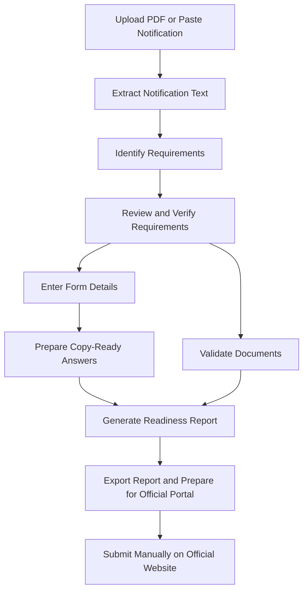

# SubmitSure

### Prepare smarter. Apply with confidence.

**SubmitSure is an application-preparation workspace that helps students, job seekers, and exam candidates understand official notifications, organise form answers, validate documents, and prepare for submission with fewer avoidable mistakes.**

From exam applications and job recruitment to scholarships and college admissions, SubmitSure brings important requirements into one place so you can focus on completing your application correctly.

> **Important:** SubmitSure prepares and validates. It does not submit applications, log in to official portals, bypass CAPTCHAs, or guarantee eligibility or acceptance.

---

## Overview

Official application notifications often contain lengthy instructions, strict document specifications, eligibility conditions, and deadlines. Missing a small requirement can lead to unnecessary errors or even rejection.

SubmitSure simplifies this process by turning notification details into a reviewable checklist, helping users prepare copy-ready form answers and checking documents against verified requirements.

## Features

### 1. Notification Analysis
- Upload text-based PDF notifications or paste notification text.
- Extract important dates, eligibility criteria, application fees, required documents, and image specifications.
- Display source-page references where available.
- Flag missing, ambiguous, or uncertain information for manual verification.
- Review, edit, approve, or reject extracted requirements before using them.

### 2. Form Answer Preparation
- Enter personal and application details in one workspace.
- Add field labels from the official application form.
- Generate editable, copy-ready answers.
- Identify missing information instead of guessing.
- Copy prepared answers into the official portal yourself.

### 3. Document Validation
Check documents against requirements verified from the official notification.

Supported checks include:
- File format and file size
- Image dimensions
- Photo and signature specifications
- PDF file handling
- Basic readability checks

Document validation helps identify technical issues. It does not establish document authenticity or prove eligibility.

### 4. Photo and PDF Utilities
- Resize and compress JPG and PNG images.
- Target specified image dimensions and file-size limits.
- Merge multiple PDFs.
- Split PDFs into separate files.
- Reorder PDF pages.
- Compress PDFs where supported.

### 5. Application Readiness Report
Get a consolidated overview of your preparation, including:
- Completed requirements
- Missing information and documents
- Items requiring manual verification
- Readiness score with an explanation of its calculation

Export your report in **TXT, JSON, PDF, or ZIP** format.

### 6. Optional AI Assistance
- Use Groq-powered AI to help extract structured information from notification text.
- Keep AI optional so manual workflows remain available.
- Review AI-generated results before relying on them.

---

## How It Works



---

## Tech Stack

| Component | Technology |
|---|---|
| Backend | Python, Flask |
| Frontend | HTML, CSS, JavaScript |
| PDF processing | PyMuPDF |
| Image processing | Pillow |
| AI-assisted extraction | Groq API |
| Configuration | Environment variables |
| Testing | pytest |
| Deployment | Render |

---

## Getting Started

### Prerequisites

Install the following before running SubmitSure:

- Python 3.10 or a compatible version supported by the dependencies
- pip
- Git (optional, for cloning the repository)

### 1. Clone the Repository

```bash
git clone <YOUR_GITHUB_REPOSITORY_URL>
cd submitsure
```

Replace the repository URL with your actual GitHub repository URL.

### 2. Create a Virtual Environment

**Windows — PowerShell**

```powershell
python -m venv .venv
.venv\Scripts\Activate.ps1
```

If PowerShell blocks activation, use Command Prompt:

```cmd
.venv\Scripts\activate.bat
```

**macOS / Linux**

```bash
python3 -m venv .venv
source .venv/bin/activate
```

### 3. Install Dependencies

```bash
python -m pip install -r requirements.txt
```

### 4. Configure Environment Variables

Copy the example environment file:

**Windows — PowerShell**

```powershell
Copy-Item .env.example .env
```

**macOS / Linux**

```bash
cp .env.example .env
```

Configure the following variables if AI assistance is required:

```env
GROQ_API_KEY=your_groq_api_key
GROQ_MODEL=your_supported_groq_model
```

Use a model currently supported by your Groq account and application code.

**Security:** Never commit your `.env` file, API keys, passwords, or other secrets to GitHub. Keep `.env.example` limited to placeholder values.

AI configuration is optional if you intend to use SubmitSure's manual workflow.

### 5. Run the Application

```bash
python app.py
```

Open the following address in your browser:

**http://localhost:5000**

### 6. Run Tests

```bash
pytest
```

---

## Deployment

SubmitSure includes a `render.yaml` configuration for Render deployment.

General deployment steps:

1. Push the project to GitHub.
2. Create a new Render service connected to the repository.
3. Configure the build and start commands according to `render.yaml`.
4. Add `GROQ_API_KEY` and `GROQ_MODEL` as environment variables if AI is enabled.
5. Deploy and test the application using the generated URL.

Review your Render configuration and application settings before deployment. Do not expose secrets in source code or logs.

---

## Privacy and Security

SubmitSure is designed to minimise the handling of sensitive application information.

- **Browser-based profile:** Profile details stay in the current browser tab and are cleared on refresh, as implemented by the application.
- **Temporary file processing:** Uploaded files are processed in memory and are not intentionally retained by the application.
- **Limited AI data sharing:** When AI is enabled, extracted notification text and form-field labels are sent to the configured AI provider.
- **Sensitive documents:** Photos, signatures, and identity documents are not sent to the AI provider.
- **No credential collection:** Users should never enter portal passwords, OTPs, or other authentication secrets.

Privacy behaviour depends on the actual implementation and deployment environment. Review server logs, temporary-file handling, and provider policies before using real personal documents.

---

## Limitations

- **No OCR:** Scanned PDFs require text to be supplied separately.
- **AI is not infallible:** Extracted dates, fees, eligibility rules, and document specifications must be checked against the official notification.
- **No eligibility guarantee:** Document checks do not prove that an applicant meets the official eligibility criteria.
- **No authenticity verification:** The application does not certify that uploaded documents are genuine.
- **No automated submission:** Users must complete and submit the application through the official portal.
- **Readiness is not acceptance:** A readiness score indicates preparation progress, not the probability of selection or approval.

Always treat the official notification and application portal as the final sources of truth.

---

## Who Is SubmitSure For?

- Students applying for college admissions and scholarships
- Candidates preparing for competitive examinations
- Job seekers completing recruitment applications
- Applicants managing multiple documents and strict upload requirements

---

## Roadmap

Potential future improvements include:

- [ ] OCR support for scanned notifications
- [ ] More advanced image and PDF validation
- [ ] Reusable application profiles with explicit save and privacy controls
- [ ] Improved extraction confidence indicators
- [ ] Additional export formats and report customisation
- [ ] Expanded automated tests for file processing and validation

---

## Contributing

Contributions, bug reports, and feature suggestions are welcome.

1. Fork the repository.
2. Create a feature branch.
3. Make your changes and add relevant tests.
4. Run `pytest`.
5. Open a pull request describing your changes.

Please avoid including real identity documents, personal application data, or API keys in issues, pull requests, and test fixtures.

---

## License

No license has been specified yet. If you plan to make SubmitSure open source, add a `LICENSE` file with the license you choose.

---

**SubmitSure — Understand the requirements. Prepare your answers. Check before you submit.**
